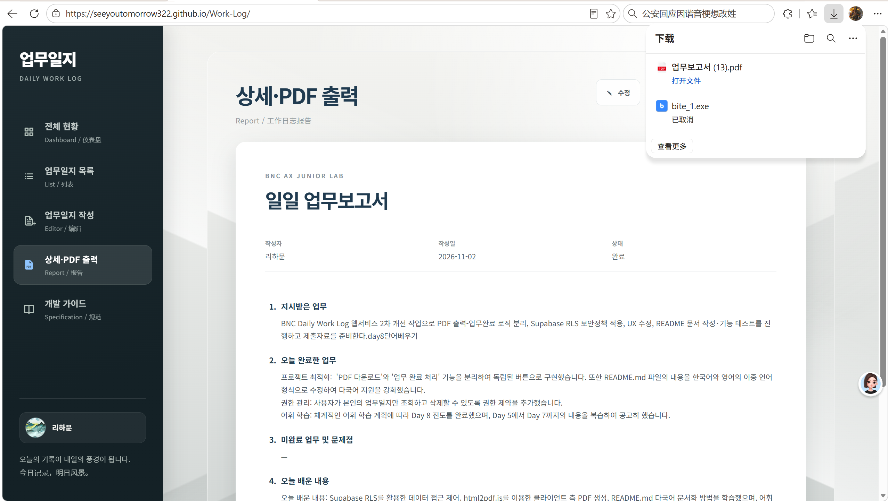
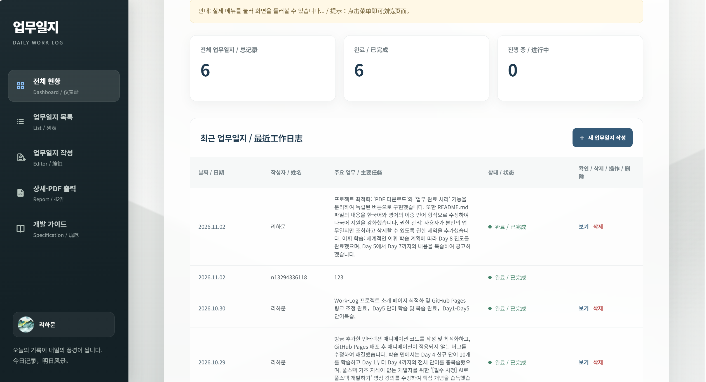
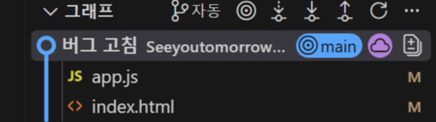
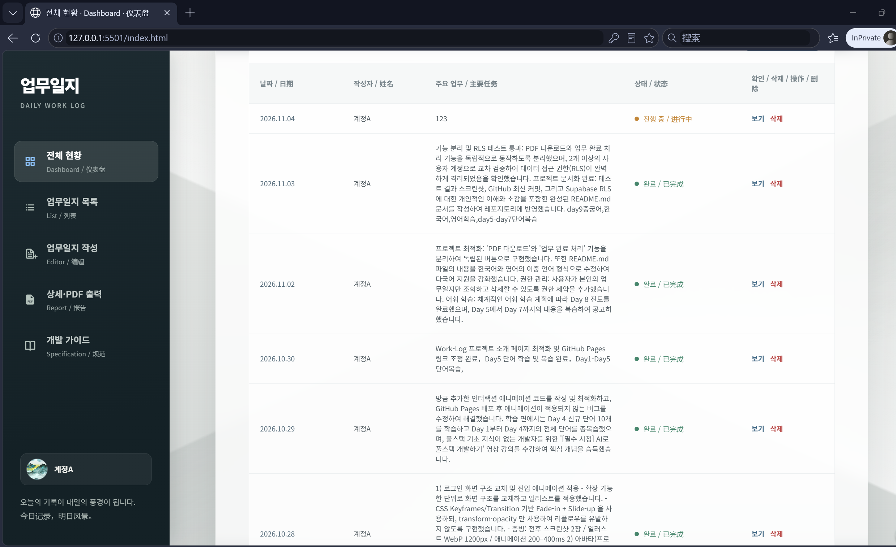
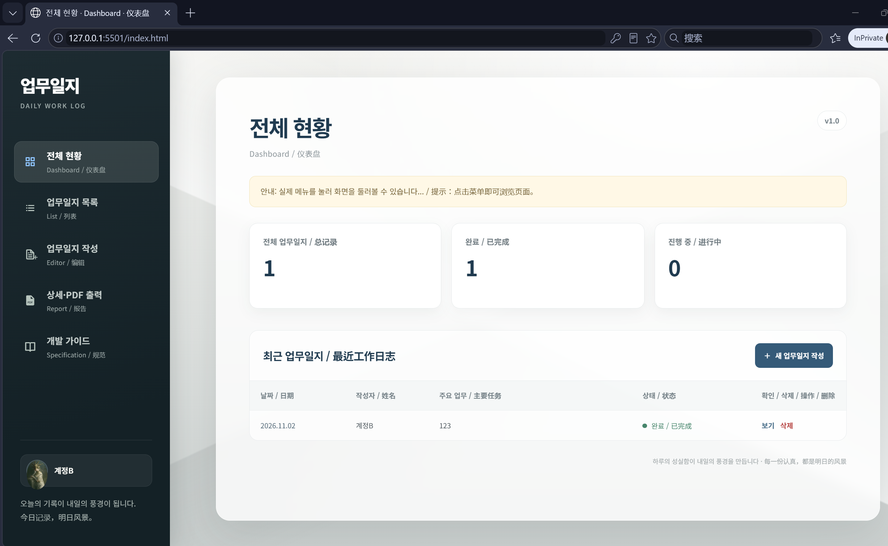

# 업무일지 (Daily Work Log)

Supabase를 통해 사용자 인증, 데이터베이스, 프로필 이미지 저장 기능을 제공하는 HTML, CSS, 순수 JavaScript 기반의 다국어 업무일지 애플리케이션입니다. (A multilingual work-log application built with HTML, CSS, and vanilla JavaScript, using Supabase for authentication, database, and avatar storage.)

## 주요 기능 (Features)

- 이메일과 비밀번호를 이용한 회원가입, 로그인, 로그아웃 및 비밀번호 재설정을 지원합니다. (Sign up, sign in, sign out, and password reset with email and password.)
- 업무일지를 생성, 조회, 수정 및 삭제할 수 있습니다. (Create, view, edit, and delete work logs.)
- 대시보드에서 업무일지와 상태를 요약하고 날짜별로 확인할 수 있습니다. (Review work-log summaries and statuses on the dashboard, and browse logs by date.)
- 사용자 닉네임과 프로필 이미지를 관리할 수 있습니다. (Manage user nicknames and profile images.)
- 업무일지 상세 내용을 미리 보고, 완료 처리된 일지를 PDF로 내보낼 수 있습니다. (Preview work-log details and export completed logs as PDF.)
- 한국어, 중국어, 영어가 혼합된 인터페이스를 제공합니다. (Provides an interface that combines Korean, Chinese, and English.)

## 디렉터리 구조 (Directory Structure)

```text
.
├── index.html                    # 메인 애플리케이션 페이지: 로그인, 대시보드, 일지 목록, 편집 및 보고서 (Main app page: sign-in, dashboard, log list, editor, and reports)
├── app.js                        # 메인 애플리케이션 로직 및 Supabase 데이터 접근 (Main app logic and Supabase data access)
├── style.css                     # 페이지 스타일 및 반응형 레이아웃 (Page styles and responsive layout)
├── TEST_CHECKLIST.md             # 주요 기능과 권한 검증을 위한 수동 테스트 체크리스트 (Manual feature and access-control test checklist)
├── reset-password.html           # 비밀번호 재설정 페이지 (Password reset page)
├── reset-password.js             # 비밀번호 재설정 및 Supabase 초기화 로직 (Password reset and Supabase initialization logic)
├── login-office-illustration.png # 로그인 페이지 일러스트 (Sign-in page illustration)
└── assets/
    └── login-illustration-hd.png # 로그인 페이지에서 사용하는 고해상도 일러스트 (High-resolution illustration used on the sign-in page)
```

애플리케이션은 CDN을 통해 Supabase JS, html2canvas, jsPDF를 불러옵니다. 현재 저장소에는 npm 빌드 스크립트, Supabase CLI 설정 또는 데이터베이스 마이그레이션 파일이 없습니다. (The app loads Supabase JS, html2canvas, and jsPDF from CDNs. The repository currently has no npm build scripts, Supabase CLI configuration, or database migration files.)

## 로컬 실행 (Local Development)

### 필수 환경 (Requirements)

- Python 3 또는 VS Code Live Server 확장 프로그램이 필요합니다. (Python 3 or the VS Code Live Server extension.)
- 로컬 Supabase를 실행하려면 Docker Desktop과 Supabase CLI가 필요합니다. (Docker Desktop and the Supabase CLI are required to run Supabase locally.)
- Supabase CLI는 `npx`로 실행할 수 있으며, Node.js와 npm이 설치되어 있어야 합니다. (The Supabase CLI can be run with `npx`; Node.js and npm must be installed.)

### 프런트엔드 실행 (Run the Frontend)

프로젝트 루트에서 정적 HTTP 서버를 시작합니다. (Start a static HTTP server from the project root.)

```powershell
py -m http.server 5501
```

그런 다음 다음 주소에 접속합니다. (Then open one of the following URLs.)

- 메인 애플리케이션 (Main app): <http://localhost:5501/>
- 비밀번호 재설정 페이지 (Password reset page): <http://localhost:5501/reset-password.html>

VS Code Live Server를 사용할 수도 있습니다. 저장소의 편집기 설정은 포트를 `5501`로 지정합니다. (You can also use VS Code Live Server. The repository's editor settings configure it to use port `5501`.)

### 로컬 Supabase 시작 (Start Supabase Locally)

1. 프로젝트 루트에서 Supabase 설정을 초기화하고 로컬 서비스를 시작합니다. (Initialize the Supabase configuration and start the local services from the project root.)

   ```powershell
   npx supabase@latest init
   npx supabase@latest start
   ```

   처음 시작할 때 필요한 컨테이너 이미지를 다운로드합니다. Supabase Studio와 로컬 API 주소는 명령 출력에 표시됩니다. (The required container images are downloaded on first startup. The command output lists the Supabase Studio and local API URLs.)

2. 데이터베이스 마이그레이션을 생성합니다. (Create a database migration.)

   ```powershell
   npx supabase@latest migration new initial_schema
   ```

   아래 “데이터베이스 테이블 및 RLS 예시”의 SQL을 새로 생성된 `supabase/migrations/<timestamp>_initial_schema.sql` 파일에 넣습니다. (Place the SQL from “Database Tables and RLS Example” below into the newly generated `supabase/migrations/<timestamp>_initial_schema.sql` file.)

3. 마이그레이션을 적용하고 로컬 연결 정보를 확인합니다. (Apply the migration and check the local connection details.)

   ```powershell
   npx supabase@latest db reset
   npx supabase@latest status
   ```

4. `app.js`와 `reset-password.js`의 `SUPABASE_URL` 및 `SUPABASE_ANON_KEY`를 `status` 출력에 표시된 로컬 API URL과 anon/publishable key로 각각 바꿉니다. 두 파일은 동일한 Supabase 프로젝트를 가리켜야 합니다. 프런트엔드 코드에 `service_role` key를 넣지 마세요. (In `app.js` and `reset-password.js`, replace `SUPABASE_URL` and `SUPABASE_ANON_KEY` with the local API URL and anon/publishable key shown by `status`. Both files must point to the same Supabase project. Do not put a `service_role` key in frontend code.)

5. Supabase Auth URL 설정에서 로컬 프런트엔드 주소(예: `http://localhost:5501` 및 `http://127.0.0.1:5501`)를 허용하고 비밀번호 재설정 주소도 허용된 리디렉션 URL에 추가합니다. 회원가입 및 비밀번호 재설정 테스트에 사용할 Inbucket 메일 테스트 서비스 주소는 로컬 Supabase 출력에서 확인할 수 있습니다. (In the Supabase Auth URL configuration, allow the local frontend URLs (for example, `http://localhost:5501` and `http://127.0.0.1:5501`) and add the password reset URL to the allowed redirect URLs. The local Supabase output includes the Inbucket email testing service URL for sign-up and password reset.)

현재 저장소에는 `supabase/` 설정과 마이그레이션이 없습니다. `init` 명령을 실행하면 프로젝트 루트에 해당 파일이 생성됩니다. 기존 클라우드 Supabase 프로젝트만 사용하려면 로컬 Supabase를 시작할 필요 없이 정적 프런트엔드만 실행하면 됩니다. (The repository currently has no `supabase/` configuration or migrations; running `init` creates them in the project root. If you only want to use an existing cloud Supabase project, you do not need to start Supabase locally—just run the static frontend.)

## 데이터베이스 테이블 및 RLS 예시 (Database Tables and RLS Example)

애플리케이션은 `public.users`, `public.work_logs` 테이블과 `avatars`라는 Storage bucket을 사용합니다. 아래 SQL은 개인 업무일지에 적합한 최소 권한 예시로, 사용자는 자신의 프로필과 일지만 읽고 쓸 수 있습니다. 인터페이스에는 “전체 일지” 목록이 있지만, 이 정책을 활성화하면 API는 현재 사용자의 일지만 반환합니다. (The app uses the `public.users` and `public.work_logs` tables and a Storage bucket named `avatars`. The SQL below is a least-privilege example for personal work logs: users can read and write only their own profiles and logs. Although the interface includes an “All Logs” list, enabling these policies means the API returns only the current user's logs.)

```sql
create table public.users (
  user_id uuid primary key references auth.users (id) on delete cascade,
  username text not null,
  avatar_url text,
  updated_at timestamptz not null default now()
);

create table public.work_logs (
  id uuid primary key default gen_random_uuid(),
  author text not null,
  user_id uuid not null references public.users (user_id) on delete cascade,
  date date,
  status text not null default '진행 중',
  assigned_work text not null default '',
  completed_work text not null default '',
  unfinished_work text not null default '',
  learning text not null default '',
  tomorrow_plan text not null default '',
  created_at timestamptz not null default now()
);

alter table public.users enable row level security;
alter table public.work_logs enable row level security;

grant select, insert, update on public.users to authenticated;
grant select, insert, update, delete on public.work_logs to authenticated;

create policy "Users can read their own profile"
  on public.users for select to authenticated
  using (user_id = (select auth.uid()));

create policy "Users can create their own profile"
  on public.users for insert to authenticated
  with check (user_id = (select auth.uid()));

create policy "Users can update their own profile"
  on public.users for update to authenticated
  using (user_id = (select auth.uid()))
  with check (user_id = (select auth.uid()));

create policy "Users can read their own work logs"
  on public.work_logs for select to authenticated
  using (auth.uid() = user_id);

create policy "Users can create their own work logs"
  on public.work_logs for insert to authenticated
  with check (user_id = (select auth.uid()));

create policy "Users can update their own work logs"
  on public.work_logs for update to authenticated
  using (auth.uid() = user_id)
  with check (auth.uid() = user_id);

create policy "Users can delete their own work logs"
  on public.work_logs for delete to authenticated
  using (auth.uid() = user_id);

insert into storage.buckets (id, name, public)
values ('avatars', 'avatars', true)
on conflict (id) do update set public = excluded.public;

create policy "Anyone can view public avatars"
  on storage.objects for select
  using (bucket_id = 'avatars');

create policy "Users can upload avatars to their own folder"
  on storage.objects for insert to authenticated
  with check (
    bucket_id = 'avatars'
    and (storage.foldername(name))[1] = (select auth.uid())::text
  );

create policy "Users can update avatars in their own folder"
  on storage.objects for update to authenticated
  using (
    bucket_id = 'avatars'
    and (storage.foldername(name))[1] = (select auth.uid())::text
  )
  with check (
    bucket_id = 'avatars'
    and (storage.foldername(name))[1] = (select auth.uid())::text
  );

create policy "Users can delete avatars in their own folder"
  on storage.objects for delete to authenticated
  using (
    bucket_id = 'avatars'
    and (storage.foldername(name))[1] = (select auth.uid())::text
  );
```

### RLS 설정 안내 (RLS Configuration Notes)

- **먼저 RLS를 활성화한 다음 접근 권한을 부여하세요.** `authenticated`에 SQL 권한을 부여해도 RLS를 우회할 수 없으며, 각 작업은 해당 정책을 통과해야 합니다. (**Enable RLS before granting access.** Granting SQL privileges to `authenticated` does not bypass RLS; each operation must still satisfy its policy.)
- `USING`은 읽기, 수정 또는 삭제할 수 있는 기존 행을 제한하고, `WITH CHECK`는 삽입 또는 수정 후 저장할 수 있는 행을 제한합니다. `auth.uid()`와 `user_id`를 비교하면 다른 사용자의 소유자로 가장한 데이터 저장을 방지할 수 있습니다. (`USING` restricts which existing rows can be read, updated, or deleted; `WITH CHECK` restricts which rows can be saved after insertion or update. Comparing `auth.uid()` with `user_id` prevents users from claiming another user's records.)
- 프로필의 `user_id`는 Supabase Auth 사용자 ID에 대응하며, 로그의 `user_id`도 해당 프로필을 참조합니다. 사용자가 처음 로그인하면 애플리케이션이 프로필을 생성합니다. (The profile's `user_id` corresponds to the Supabase Auth user ID, and each log's `user_id` references that profile. The app creates a profile when a user signs in for the first time.)
- 아바타 bucket은 공개로 설정되어 누구나 이미지를 읽을 수 있습니다. 업로드, 교체, 삭제는 객체 경로가 현재 사용자 ID로 시작하는 파일에만 허용됩니다. 공개 bucket에 민감한 파일을 저장하지 마세요. (The avatar bucket is public, so anyone can read its images. Upload, replacement, and deletion are limited to files whose object paths start with the current user's ID. Do not store sensitive files in a public bucket.)
- 이 프로젝트의 권한 요구사항은 사용자별 일지 격리입니다. 다른 사용자에게 로그 `SELECT`를 허용하는 정책을 추가하지 마세요. PostgreSQL의 기본 permissive 정책은 여러 개가 OR로 결합되므로, 기존의 더 넓은 `SELECT`·`UPDATE`·`DELETE` 정책도 확인하고 제거해야 합니다. (This project's access requirement is per-user log isolation. Do not add a policy allowing other users to `SELECT` logs. PostgreSQL's permissive policies are combined with OR, so check for and remove any existing broader `SELECT`, `UPDATE`, or `DELETE` policies.)

> 브라우저 코드에서 `service_role` key를 사용하지 마세요. 이 key는 RLS를 우회할 수 있으므로 신뢰할 수 있는 서버 환경에만 보관해야 합니다. (Do not use a `service_role` key in browser code. It can bypass RLS and must be kept only in a trusted server environment.)

### 테스트 결과 (Test Results)

| 테스트 항목 | 예상 결과 | 실제 결과 | 테스트 결론 |
|---|---|---|---|
| PDF 다운로드 및 업무 완료 처리 기능 분리 | PDF 다운로드와 업무 완료 처리가 서로 독립적으로 동작합니다. | 기능 분리 테스트 성공 (증적 참조) | 통과 |
| RLS 권한 격리: 타인 계정 접근 및 수정 | 다른 계정의 일지 접근과 수정이 차단됩니다. | 권한 격리 테스트 성공 (증적 참조) | 통과 |

### Copilot AI 테스트 검증 기록

아래 항목은 Copilot이 정리한 기능 테스트 기록 양식입니다. 테스트를 실행한 뒤 실제 결과와 결론을 기입하며, 미실행 항목은 통과로 표시하지 않습니다. 권한 테스트는 Supabase RLS 정책이 적용된 환경에서 진행합니다.

| 테스트 항목 | 예상 결과 | 실제 결과 | 테스트 결론 |
|---|---|---|---|
| 사용자 A가 사용자 B의 일지 조회 시도 | RLS에 의해 일지 내용이 반환되지 않고, 사용자 A에게 다른 사용자의 일지가 노출되지 않습니다. | RLS 정책 적용으로 인해 요청이 거부되었습니다. | ☑ 통과 □ 실패 □ 보류 |
| 사용자 A가 사용자 B의 일지 수정 시도 | 수정 요청이 거부되거나 대상 행이 변경되지 않으며, 사용자 B의 일지 내용은 그대로 유지됩니다. | RLS 정책 적용으로 인해 요청이 거부되었습니다. | ☑ 통과 □ 실패 □ 보류 |
| 사용자 A가 사용자 B의 일지 삭제 시도 | 삭제 요청이 거부되거나 대상 행이 삭제되지 않고, 사용자 B의 일지가 그대로 남습니다. | RLS 정책 적용으로 인해 요청이 거부되었습니다. | ☑ 통과 □ 실패 □ 보류 |
| 완료된 일지의 PDF 다운로드 | PDF 파일이 다운로드되고, 일지 내용이 포함됩니다. 다운로드 동작이 일지 상태를 변경하지 않습니다. | 기능 정상 동작. 상태 변경 없이 PDF 다운로드 성공. | ☑ 통과 □ 실패 □ 보류 |
| 미완료 일지의 PDF 다운로드 | PDF 파일이 다운로드되며, 다운로드만으로 일지가 완료 처리되거나 상태가 변경되지 않습니다. | 기능 정상 동작. 상태 변경 없이 PDF 다운로드 성공. | ☑ 통과 □ 실패 □ 보류 |
| 업무 완료 처리 | 저장된 미완료 일지의 상태가 `완료`로 바뀌고, 상세 화면과 목록에 변경된 상태가 반영됩니다. | 정상 동작. 상태가 완료로 변경됨. | ☑ 통과 □ 실패 □ 보류 |

**테스트 환경 및 증적**

- 실행 날짜 / 빌드 또는 배포 버전: 2026-11-04
- 브라우저 및 버전: Microsoft Edge 156.0.4314.58 (공식 버전) (64비트)
- 테스트 계정 및 데이터(민감정보 제외): 13944346515@qq.com

**1. PDF 다운로드 및 기능 분리 테스트 성공**



**2. RLS 권한 격리 테스트 성공**



**3. GitHub 최신 커밋 기록**



**3.1. 사용자 역할에 따른 데이터 격리 테스트 (用户角色数据隔离测试)**

배경:

지도교수님은 "일반 사용자의 대시보드 목록에는 절대로 본인 외의 다른 사람이 작성한 데이터가 표시되지 않아야 한다"고 요구했습니다.
이에 Supabase RLS(Row-Level Security) 정책과 프론트엔드 렌더링 로직을 이중으로 적용하여 테스트했습니다.

테스트 시나리오 및 결과:

1. Test Account A (계정A)로 로그인하여 "123" 제목의 일지를 작성하고 저장했습니다.
2. Test Account B (계정B)로 로그인하여 대시보드를 확인했습니다.
결과: Test Account B의 대시보드에는 A가 작성한 "123" 일지가 전혀 표시되지 않으며, 오직 B의 데이터만 렌더링됨을 확인했습니다.

[Test Account A (계정A)]의 대시보드 화면:



[Test Account B (계정B)]의 대시보드 화면:



### 4. RLS(행 수준 보안)에 대한 이해

제가 배운 RLS는 '행 수준 보안(Row-Level Security)'을 뜻하며, 데이터베이스의 보안을 담당하는 핵심 기능입니다.

**4. RLS는 어떻게 데이터를 보호할까요?**

RLS는 '데이터베이스에 붙이는 필터'와 같습니다. 제가 `app.js`에서 `select * from work_logs`라는 코드를 입력해 모든 데이터를 불러오려고 하더라도, 데이터베이스가 자동으로 내 계정 ID와 일치하는 데이터만 남겨서 보여줍니다. 즉, 다른 사람의 데이터는 필터에 걸려 내 화면으로 넘어오지 못하게 합니다.

**5. 왜 이렇게 할까요? (AI의 도움과 제 이해)**

초기에는 AI가 RLS 설정과 `auth.uid()`라는 코드를 도와주었지만, 저는 이 원리를 이해했습니다. `auth.uid()`는 현재 로그인한 사람의 고유한 ID를 뜻합니다. 데이터베이스가 이 ID를 확인해 해당 데이터의 소유자를 판단하고, 권한에 맞는 데이터만 반환하게 합니다.

이 과정을 통해 RLS는 프런트엔드에서 단순히 버튼을 숨기는 것이 아니라, 데이터베이스 단계에서 다른 사용자의 데이터를 격리해 보안을 제공한다는 것을 깨달았습니다.
